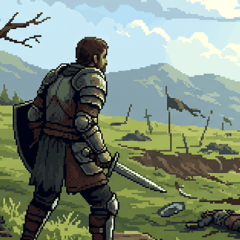
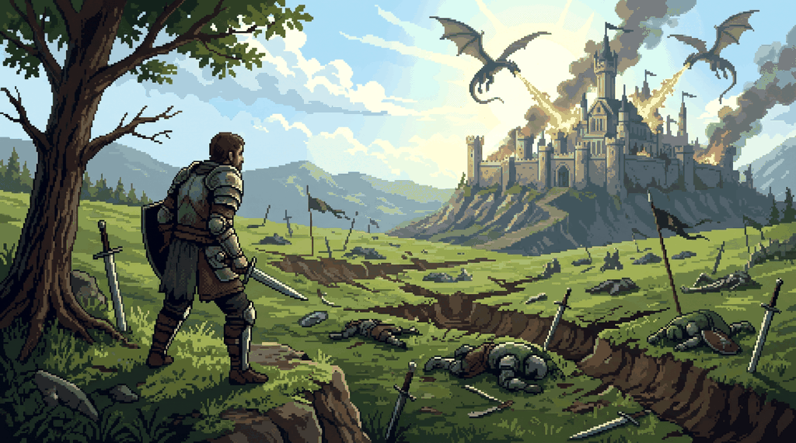

 

&nbsp;

&nbsp;

&nbsp;

 

---

## 👨‍💻 Who are you?

<table>
<tr>
<td width="68%" valign="top">

I am a student in <strong>Software Engineering and Digitalization</strong> at <strong>ENSEM Casablanca</strong>. My primary goal as an engineer is to transform tedious manual processes into automated software solutions, generating massive time savings and immediate value.

Solving complex problems stimulates my ingenuity. I demonstrate strong autonomy in managing end-to-end projects and cultivate absolute rigor regarding data criticality—an essential trait in industrial and financial environments.

</td>
<td width="32%" align="center" valign="middle">

</td>
</tr>
</table>

---

 

*Deconstructing complexity reveals excellence.*

---

**© 2026 Abdelbari REFAK · All rights reserved**

